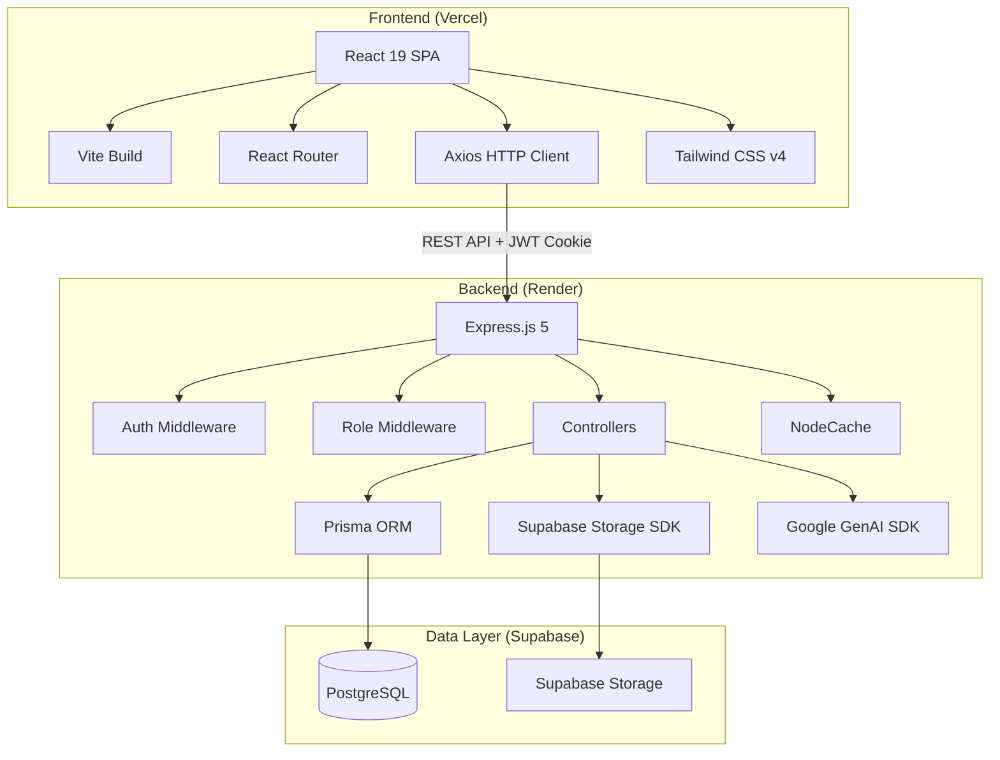
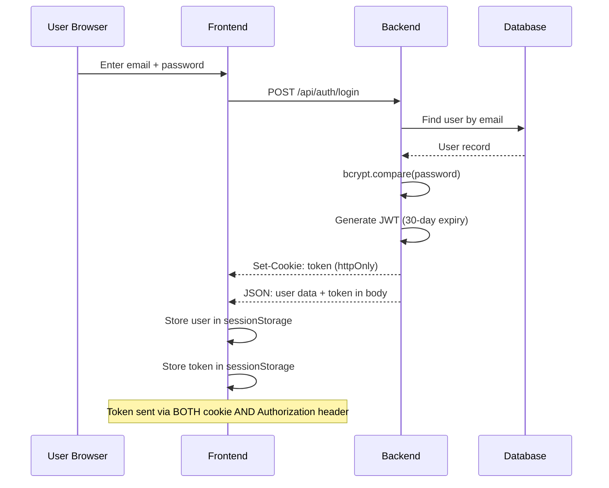
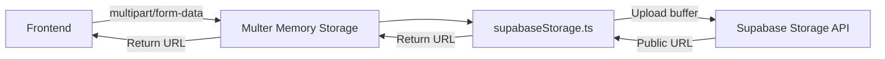

# BizTask Current Architecture

> **Last Updated:** 2026-11-25

---

## 1. Architecture Overview

BizTask follows a **traditional client-server architecture** with a React SPA frontend and an Express.js REST API backend, connected to a PostgreSQL database via Prisma ORM.



---

## 2. Authentication Flow



### Authentication Issues Identified
- **Dual token transmission**: Token is stored in both httpOnly cookie AND sessionStorage, then sent via both `Cookie` and `Authorization: Bearer` header
- **30-day JWT expiry**: No refresh token mechanism
- **No token revocation**: JWTs cannot be invalidated server-side
- **sessionStorage for user data**: Lost on tab close, but cookie persists → state mismatch possible
- **Fallback secret**: `process.env.JWT_SECRET || 'fallback_secret'` — insecure default

---

## 3. API Layer

### Route Registration (index.ts)
```
/api/health        → Health check (no auth)
/api/auth          → Auth routes (login, logout, password)
/api/users         → User CRUD (auth + role)
/api/tasks         → Task CRUD (auth + role)
/api/submissions   → Task submissions (auth)
/api/daily-reports → Daily reports (auth)
/api/dashboard     → Dashboard stats (auth + role)
/api/notifications → Notification CRUD (auth)
/api/activity-logs → Activity logs (auth + role)
/api/upload        → File uploads (auth)
/api/system        → System admin (auth + role)
/api/ai            → AI voice parsing (auth)
```

### Middleware Chain
1. `cors` — Origin-based in production, permissive in development
2. `express.json()` — Body parser
3. `cookieParser()` — Cookie parsing
4. Per-route: `authenticateToken` → `authorizeRoles(...)` → Controller

### Response Patterns
- Success: `res.json(data)` or `res.status(200).json({ message: ... })`
- Error: `res.status(4xx/5xx).json({ message: ... })`
- **No consistent error response schema**
- **No request validation library** (manual checks only)

---

## 4. Database Layer

### Prisma Client (Singleton Pattern)
```typescript
// prismaClient.ts — Global singleton to prevent connection exhaustion
const globalForPrisma = global as unknown as { prisma: PrismaClient };
const prisma = globalForPrisma.prisma || new PrismaClient();
if (process.env.NODE_ENV !== 'production') globalForPrisma.prisma = prisma;
```

### Schema Provider
- **Provider:** PostgreSQL (Supabase)
- **Connection:** Via `DATABASE_URL` (transaction pooler) and `DIRECT_URL` (session pooler)
- **ID Strategy:** Auto-increment integers (spec recommends UUIDs)
- **Soft Delete:** Implemented on Task, TaskSubmission, DailyReport, ActivityLog via `isDeleted` flag
- **Timestamps:** `createdAt` and `updatedAt` on most models
- **Audit Fields:** `ipAddress` and `userAgent` on ActivityLog only

### Migration Status
- **No migrations directory found** — Schema managed via `prisma db push`
- **⚠️ RISK:** `prisma db push` can cause data loss in production. Must migrate to `prisma migrate` before production use.

---

## 5. File Storage



- **Storage bucket:** `bizleap-proofs` (PUBLIC bucket)
- **File naming:** `{timestamp}-{sanitized_original_name}`
- **Access control:** None — files are publicly accessible via URL
- **⚠️ RISK:** Any file uploaded becomes publicly accessible. No signed URLs or access control.

---

## 6. Caching Strategy

- **NodeCache** with 5-minute TTL on dashboard endpoints
- Cache key: `{dashboardType}_{startDate}_{endDate}_{department}`
- **No cache invalidation** when underlying data changes
- **No distributed cache** — cache is per-process and lost on restart

---

## 7. Frontend Architecture

### State Management
- **No global state manager** (no Redux, Zustand, or Context)
- User data stored in `sessionStorage`
- Each page manages its own state via `useState`/`useEffect`
- API calls made directly in page components

### Routing & Guards
- `AuthGuard` component checks `sessionStorage` for token
- Role-based routing via `allowedRoles` prop on `AuthGuard`
- **Frontend-only guards** — backend also checks, but inconsistently

### Component Architecture
- **5 shared components**: AuthGuard, Layout, Logo, NotificationBell, TaskProgressionWidget
- **13 page components** + 4 dashboard variants
- **10 service files** wrapping Axios calls
- **No reusable form components, modals, or table components** — all inline

### Styling
- Tailwind CSS v4 with custom CSS variables in `index.css`
- Custom brand colors: `--color-brand-black`, `--color-brand-matte`
- Badge classes: `badge-success`, `badge-danger`, `badge-warning`, `badge-neutral`
- Shadow: `shadow-pepper` custom shadow
- **Generally consistent** but some hardcoded colors mixed with variables

---

## 8. Build & Deployment

### Backend Build
```
npm install → tsc → node dist/index.js
```
Vercel: Uses `api/index.ts` as serverless entry point (re-exports Express app)

### Frontend Build
```
tsc -b && vite build → dist/
```
Environment: `VITE_API_URL` points to backend

### Deployment Config
- **Backend:** Render Web Service with Vercel fallback
- **Frontend:** Vercel with `_redirects` file for SPA routing
- **Database:** Supabase PostgreSQL
- **No CI/CD pipeline configured**
- **No Docker containerization**
- **No environment-specific configs** beyond `.env.example`

---

## 9. Areas of Technical Debt

1. **No automated tests** — zero test files
2. **No input validation library** — manual checks prone to bypass
3. **No API versioning** — routes use `/api/` without version prefix
4. **No rate limiting** — APIs vulnerable to abuse
5. **No request logging middleware** — only error console.log
6. **No OpenAPI/Swagger documentation**
7. **Debug scripts committed** (fixPassword.ts, dumpUsers.ts)
8. **SQLite dev.db committed** to repo
9. **No database migrations** — using `prisma db push`
10. **Inconsistent error handling** — some endpoints swallow errors
11. **`any` types throughout** — TypeScript benefits reduced
12. **No background job system** — only API-triggered deadline checks
