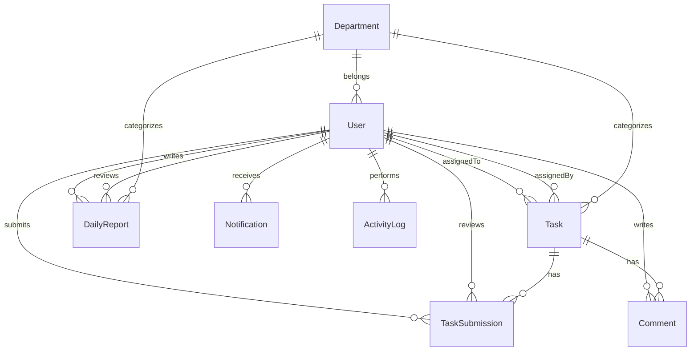

# BizTask Database Documentation

> **Last Updated:** 2026-11-25

---

## 1. Current Database Provider

| Property | Value |
|----------|-------|
| Provider | PostgreSQL |
| Hosting | Supabase |
| ORM | Prisma 5.14.0 |
| Connection | Transaction pooler (`DATABASE_URL`) + Session pooler (`DIRECT_URL`) |
| ID Strategy | Auto-increment integers |
| Migration Tool | None — using `prisma db push` (⚠️ unsafe for production) |

---

## 2. Current Schema (7 Models)

### 2.1 User
| Column | Type | Constraints | Notes |
|--------|------|-------------|-------|
| id | Int | PK, autoincrement | |
| name | String | required | |
| email | String | unique, required | |
| password | String | required | bcrypt hash |
| role | String | default "Viewer" | SuperAdmin, Manager, DevEmployee, MediaEmployee, Viewer |
| designation | String? | optional | |
| isActive | Boolean | default true | |
| mustChangePassword | Boolean | default true | Forced password change on first login |
| resetPasswordRequested | Boolean | default false | |
| canResetPassword | Boolean | default false | |
| departmentId | Int? | FK → Department.id | |
| createdAt | DateTime | default now() | |
| updatedAt | DateTime | @updatedAt | |

**Indexes:** `role`, `departmentId`

### 2.2 Department
| Column | Type | Constraints |
|--------|------|-------------|
| id | Int | PK, autoincrement |
| name | String | unique, required |
| createdAt | DateTime | default now() |

**Seeded values:** Management (1), Development (2), Media (3)

### 2.3 Task
| Column | Type | Constraints | Notes |
|--------|------|-------------|-------|
| id | Int | PK, autoincrement | |
| title | String | required | |
| description | String | required | |
| category | String | required | |
| priority | String | default "Medium" | Low, Medium, High, Urgent |
| status | String | default "Pending" | Pending, In Progress, Submitted, Approved, Rejected, Overdue |
| deadline | DateTime | required | |
| proofRequired | Boolean | default true | |
| proofType | String? | optional | Image, PDF, Video, etc. |
| clientName | String? | optional | Free-text (not FK) |
| clientDetails | String? | optional | |
| driveLink | String? | optional | |
| socialMediaPlatform | String? | optional | |
| postType | String? | optional | |
| githubRepo | String? | optional | |
| environment | String? | optional | |
| departmentId | Int | FK → Department.id | |
| assignedToId | Int? | FK → User.id | |
| assignedById | Int | FK → User.id | |
| isDeleted | Boolean | default false | Soft delete |
| createdAt | DateTime | default now() | |
| updatedAt | DateTime | @updatedAt | |

**Indexes:** `status`, `departmentId`, `assignedToId`, `deadline`

### 2.4 TaskSubmission
| Column | Type | Constraints |
|--------|------|-------------|
| id | Int | PK, autoincrement |
| taskId | Int | FK → Task.id |
| userId | Int | FK → User.id |
| reportText | String | required |
| proofUrl | String? | optional |
| proofFileName | String? | optional |
| proofType | String? | optional |
| notes | String? | optional |
| completionPercentage | Int | default 100 |
| blockers | String? | optional |
| reviewStatus | String | default "Pending Review" |
| managerFeedback | String? | optional |
| reviewedById | Int? | FK → User.id |
| submittedAt | DateTime | default now() |
| reviewedAt | DateTime? | optional |
| isDeleted | Boolean | default false |
| createdAt | DateTime | default now() |
| updatedAt | DateTime | @updatedAt |

**Indexes:** `reviewStatus`

### 2.5 DailyReport
| Column | Type | Constraints |
|--------|------|-------------|
| id | Int | PK, autoincrement |
| userId | Int | FK → User.id |
| departmentId | Int | FK → Department.id |
| reportDate | DateTime | default now() |
| workCompleted | String | required |
| pendingWork | String | required |
| blockers | String? | optional |
| tomorrowPlan | String | required |
| attachments | String | required (empty string allowed) |
| taskIds | String? | JSON array as string |
| status | String | default "Submitted" |
| managerFeedback | String? | optional |
| reviewedById | Int? | FK → User.id |
| reviewedAt | DateTime? | optional |
| isDeleted | Boolean | default false |
| createdAt | DateTime | default now() |
| updatedAt | DateTime | @updatedAt |

**Indexes:** `reportDate`, `departmentId`

### 2.6 Notification
| Column | Type | Constraints |
|--------|------|-------------|
| id | Int | PK, autoincrement |
| userId | Int | FK → User.id |
| title | String | required |
| message | String | required |
| isRead | Boolean | default false |
| type | String | required |
| entityType | String? | optional |
| entityId | Int? | optional |
| createdAt | DateTime | default now() |

**Indexes:** `createdAt`

### 2.7 ActivityLog
| Column | Type | Constraints |
|--------|------|-------------|
| id | Int | PK, autoincrement |
| userId | Int | FK → User.id |
| action | String | required |
| entityType | String? | optional |
| entityId | Int? | optional |
| description | String? | optional |
| metadata | String? | JSON as string |
| ipAddress | String? | optional |
| userAgent | String? | optional |
| isDeleted | Boolean | default false |
| createdAt | DateTime | default now() |

**Indexes:** `createdAt`

### 2.8 Comment
| Column | Type | Constraints |
|--------|------|-------------|
| id | Int | PK, autoincrement |
| taskId | Int | FK → Task.id |
| userId | Int | FK → User.id |
| content | String | required |
| createdAt | DateTime | default now() |

**No indexes, no updatedAt, no soft delete, no CRUD API routes**

---

## 3. Entity Relationship Diagram

---

## 4. Missing Tables (Required by Specification)

The following entity groups from the spec have **no database tables**:

| # | Entity Group | Spec Feature | Priority |
|---|-------------|--------------|----------|
| 1 | Client, ClientContact | F14 Client Management | HIGH |
| 2 | ClientUser, ClientMembership | F26 Client Login | HIGH |
| 3 | Project | F14, F27 | HIGH |
| 4 | Meeting, MeetingParticipant, MeetingMinutes, ActionItem | F12 Meetings | HIGH |
| 5 | CalendarIntegration, CalendarEvent | F13 Google Calendar | MEDIUM |
| 6 | Lead, LeadActivity, Deal | F17 Sales CRM | MEDIUM |
| 7 | Invoice, InvoiceItem, Payment | F18 Invoices | HIGH |
| 8 | Attendance, LeaveRequest, Holiday | F19 Attendance | MEDIUM |
| 9 | PerformanceRecord | F20 Scorecard | LOW |
| 10 | ContentCalendar, ContentItem | F07 Content Calendar | MEDIUM |
| 11 | TaskChecklist, TaskChecklistItem | F15 Task Details | MEDIUM |
| 12 | TimeEntry | F16 Time Tracking | MEDIUM |
| 13 | RecurringTask | F16 Recurring Tasks | LOW |
| 14 | ClientRequest | F28 Client Requests | MEDIUM |
| 15 | WeeklyDigest | F29 Weekly Digest | LOW |
| 16 | ScheduledJob, JobExecution | F25 Scheduled Jobs | MEDIUM |
| 17 | Setting, CompanyInfo | F11 Settings | LOW |
| 18 | Team, TeamMember | F21 Team Roster | MEDIUM |
| 19 | IntegrationAccount | Google/WhatsApp/Email | MEDIUM |

---

## 5. Schema Issues

1. **Auto-increment integers instead of UUIDs** — integers are guessable, enabling enumeration attacks
2. **No `ON DELETE` cascade rules** — manual cascade in `deleteUser` is incomplete and error-prone
3. **No `CHECK` constraints** — `role`, `status`, `priority`, `reviewStatus` accept any string
4. **`attachments` on DailyReport is non-nullable String** — stores JSON arrays as strings instead of using proper JSON column
5. **`taskIds` on DailyReport is nullable String** — stores JSON array as string
6. **No `updatedAt` on Notification, Comment** — cannot track modifications
7. **Missing `userId` index on Notification** — queries always filter by userId
8. **Missing `taskId` index on TaskSubmission and Comment**
9. **No composite unique constraint** on DailyReport (userId + reportDate) — relies on application-level check
10. **`clientName` is free text** — should be FK to Client table
